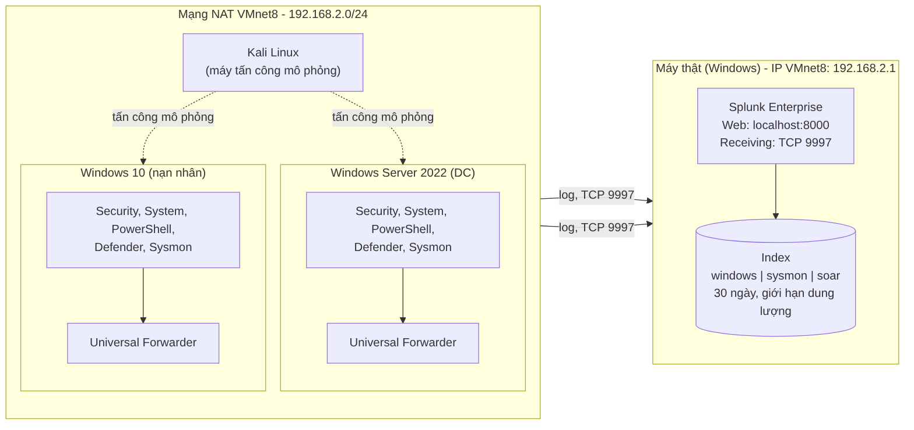
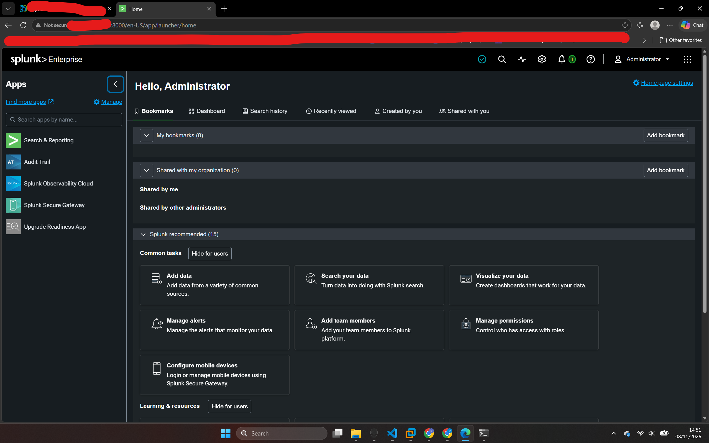
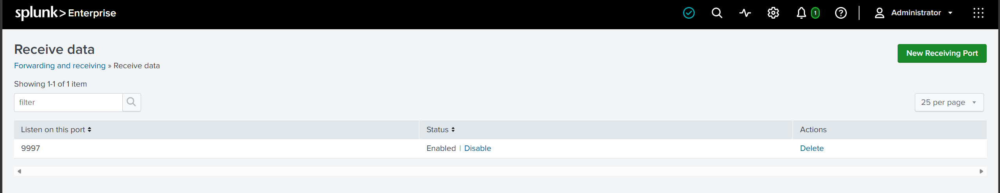

# Splunk Log Collection Setup

Tài liệu này thuật lại quá trình dựng phần thu thập log cho dự án **Detection & Response Pipeline**: cài Splunk Enterprise trên máy thật, cấu hình hai máy Windows gửi log về bằng Universal Forwarder, và kiểm tra log đã vào Splunk.

> Ảnh minh chứng đặt trong thư mục `docs/images/`. Mỗi vị trí có dòng `![...]` kèm tên file gợi ý. Chụp xong, lưu đúng tên file là ảnh sẽ hiện trong README. Danh sách đầy đủ các ảnh cần chụp ở cuối tài liệu.

---

## 1. Mục tiêu

- Thu thập log Windows Security, System, PowerShell, Defender và Sysmon từ hai máy Windows về một SIEM tập trung.
- Dữ liệu này là nền cho các rule phát hiện (Sigma) và phần tự động hóa phản ứng ở các bước sau.

## 2. Kiến trúc lab

| Thành phần | Vai trò | Ghi chú |
|---|---|---|
| Máy thật (Windows) | Splunk Enterprise | Nhận log qua cổng 9997 |
| Windows Server 2022 | Domain Controller, nguồn log | Sysmon + Universal Forwarder |
| Windows 10 | Máy nạn nhân, nguồn log | Sysmon + Universal Forwarder |
| Kali Linux | Máy tấn công mô phỏng | Cùng mạng VMnet8 |

- Mạng: cả ba VM dùng **NAT (VMnet8)**, dải `192.168.2.0/24`. Máy thật là `192.168.2.1` (adapter VMnet8).
- IP của VMnet8 không phụ thuộc Wi-Fi nên forwarder luôn trỏ tới IP này, kể cả khi máy thật đổi mạng.


<!-- Ảnh gợi ý: sơ đồ 4 máy, mũi tên log từ 2 VM Windows về Splunk (TCP 9997) -->

---

## 3. Cài Splunk Enterprise trên Windows 11

1. Cài Splunk Enterprise cho Windows với thư mục mặc định `C:\Program Files\Splunk`, đặt tài khoản quản trị.
2. Mở `http://ipaddress:8000` để đăng nhập.

Lý do cài trực tiếp trên máy thật thay vì trong VM: tách SIEM khỏi máy tấn công (Kali), tiết kiệm RAM cho các VM, và code automation sau này gọi được thẳng tới Splunk.



---

## 4. Mở cổng nhận log

Trong Splunk Web: **Settings → Forwarding and receiving → Configure receiving → New Receiving Port**, nhập `9997`.

Kiểm tra cấu hình đã có hiệu lực bằng `btool`:

```powershell
& "C:\Program Files\Splunk\bin\splunk.exe" btool inputs list splunktcp --debug
```

Kết quả cho thấy stanza `[splunktcp://9997]` nằm trong `etc\apps\search\local\inputs.conf` và không bị tắt. Log `splunkd.log` xác nhận Splunk đã tạo bộ nhận cổng 9997 (`Creating fwd data Acceptor for IPv4 port 9997`).



---

## 5. Tạo index và giới hạn dung lượng

Tạo ba index riêng cho từng nguồn: `windows`, `sysmon`, `soar`.

Index mới tạo dùng giá trị mặc định của Splunk, gồm `maxTotalDataSizeMB = 500000` (500 GB) và giữ dữ liệu khoảng 6 năm. Với một máy lab điều này có thể làm đầy ổ đĩa, nên mình đặt giới hạn trong `etc\apps\search\local\indexes.conf`:

```ini
[windows]
frozenTimePeriodInSecs = 2592000   # giữ 30 ngày
maxTotalDataSizeMB = 5000          # tối đa ~5 GB

[sysmon]
frozenTimePeriodInSecs = 2592000
maxTotalDataSizeMB = 5000

[soar]
frozenTimePeriodInSecs = 2592000
maxTotalDataSizeMB = 1000
```

Kiểm tra bằng `btool indexes list --debug` để chắc chắn giá trị đến từ file `local`.


---

## 6. Firewall trên máy thật

Chỉ cho phép dải VMnet8 gửi log tới cổng 9997:

```powershell
New-NetFirewallRule -DisplayName "Splunk Receiver 9997 (lab)" `
  -Direction Inbound -Protocol TCP -LocalPort 9997 `
  -RemoteAddress 192.168.2.0/24 -Action Allow -Profile Any
```


---

## 7. Cài Sysmon và Universal Forwarder trên hai VM Windows

Thực hiện trên Windows 10 trước, kiểm tra thành công rồi lặp lại cho Windows Server 2022.

1. Cài **Sysmon** và xác nhận dịch vụ chạy:

```powershell
Get-Service Sysmon64
```

2. Cài **Universal Forwarder** (chọn "on-premises Splunk Enterprise", để trống Deployment Server).
3. Không sửa `etc\system\default\inputs.conf` (file mặc định ghi rõ không được chỉnh sửa). Tạo cấu hình riêng trong `C:\Program Files\SplunkUniversalForwarder\etc\system\local\`.

`inputs.conf` (Windows 10):

```ini
[WinEventLog://Security]
index = windows
disabled = 0
start_from = oldest
current_only = 0

[WinEventLog://System]
index = windows
disabled = 0

[WinEventLog://Microsoft-Windows-PowerShell/Operational]
index = windows
disabled = 0

[WinEventLog://Microsoft-Windows-Windows Defender/Operational]
index = windows
disabled = 0

[WinEventLog://Microsoft-Windows-Sysmon/Operational]
index = sysmon
disabled = 0
renderXml = true
source = XmlWinEventLog:Microsoft-Windows-Sysmon/Operational
```

Trên Windows Server, stanza Security có thêm `evt_resolve_ad_obj = 1` để đổi SID thành tên đối tượng AD dễ đọc.

`outputs.conf` (cả hai máy):

```ini
[tcpout]
defaultGroup = dr_splunk

[tcpout:dr_splunk]
server = 192.168.2.1:9997
```

Kiểm tra forwarder đã đọc cấu hình từ file `local`:

```powershell
& "C:\Program Files\SplunkUniversalForwarder\bin\splunk.exe" btool inputs list WinEventLog --debug
```


---

## 8. Sự cố gặp phải và cách xử lý

Phần này ghi lại các lỗi thật trong quá trình dựng lab và cách mình xác định nguyên nhân.

### 8.1. Hai VM Windows ping được một chiều

- **Triệu chứng:** Windows 10 ping được Windows Server, chiều ngược lại thất bại.
- **Nguyên nhân:** Windows Firewall trên Windows 10 chặn ICMP Echo Request đến.
- **Cách xử lý:** thêm rule cho phép ICMPv4 đến, và dùng `Test-NetConnection` với cổng cụ thể để kiểm tra kết nối thay vì chỉ dựa vào ping.

```powershell
New-NetFirewallRule -DisplayName "Allow ICMPv4 Lab" -Protocol ICMPv4 -IcmpType 8 -Direction Inbound -Action Allow -Profile Any
```

### 8.2. Forwarder báo "inactive"

- **Triệu chứng:** `splunk.exe list forward-server` cho thấy forwarder nằm ở "Configured but inactive forwards" với đích `192.168.2.253:9997`.
- **Phân tích:** log `splunkd.log` trên máy thật cho thấy cổng 9997 đã mở. Kiểm tra IP adapter bằng `Get-NetIPAddress` thì VMnet8 là `192.168.2.1`, không phải `.253`.
- **Nguyên nhân:** địa chỉ đích của forwarder bị nhập sai khi cài đặt.
- **Cách xử lý:** dùng `btool outputs list --debug` để tìm file chứa IP sai, sửa thành `192.168.2.1:9997`, khởi động lại `SplunkForwarder`, kiểm tra lại bằng `Test-NetConnection` và `list forward-server`.


### 8.3. Index chưa tồn tại

- **Triệu chứng:** `btool indexes list windows` và `sysmon` không in ra gì.
- **Nguyên nhân:** chưa tạo index trước khi forwarder gửi dữ liệu. Splunk bỏ dữ liệu gửi vào index không tồn tại.
- **Cách xử lý:** tạo `windows`, `sysmon`, `soar` rồi đặt giới hạn dung lượng như mục 5.

### 8.4. File cấu hình mặc định không được sửa

- **Nguyên nhân tiềm ẩn:** `etc\system\default\inputs.conf` có dòng `DO NOT EDIT THIS FILE!`, thay đổi sẽ mất khi nâng cấp.
- **Cách xử lý:** mọi tùy chỉnh đặt trong `etc\system\local\` hoặc trong app. Dùng `btool --debug` để biết từng dòng cấu hình đến từ file nào.

---

## 9. Kiểm tra log đã về Splunk

Trên Splunk (máy thật), chạy:

```spl
index=windows | stats count by host
index=sysmon  | stats count by host
```

Kết quả: cả Windows 10 và Windows Server xuất hiện ở cả hai index, xác nhận pipeline thu thập hoạt động từ endpoint tới SIEM.


---

## 10. Kết quả và bước tiếp theo

**Đã hoàn thành**

- Splunk Enterprise nhận log từ hai máy Windows qua cổng 9997.
- Ba index riêng (`windows`, `sysmon`, `soar`) có giới hạn dung lượng và thời gian lưu.
- Firewall chỉ cho phép dải VMnet8 gửi log.

**Dự kiến làm tiếp**

- Cài Splunk Add-on for Microsoft Windows và Splunk Add-on for Sysmon để các trường log được tách chuẩn.
- Bật Advanced Audit Policy trên DC và Script Block Logging trên Windows 10 để có đủ sự kiện cho rule.
- Viết bộ rule Sigma đầu tiên, mô phỏng tấn công bằng Atomic Red Team và đo độ phủ MITRE ATT&CK.

---

## Danh sách ảnh minh chứng cần chụp

Lưu vào `docs/images/` đúng tên file dưới đây. Che các thông tin nhạy cảm (mật khẩu, token, tên người dùng nếu cần) trước khi đưa lên GitHub.

| Tick | File | Chụp gì |
|---|---|---|
| [ ] | `01-architecture.png` | Sơ đồ kiến trúc lab (vẽ bằng draw.io hoặc tương tự) |
| [ ] | `02-splunk-home.png` | Trang chủ Splunk Web sau khi đăng nhập |
| [ ] | `03-receiving-port-9997.png` | Settings → Forwarding and receiving → Configure receiving, thấy cổng 9997 Enabled |
| [ ] | `04-indexes.png` | Settings → Indexes, thấy `windows`, `sysmon`, `soar` |
| [ ] | `05-btool-indexes-limits.png` | Kết quả `btool indexes list --debug` có `maxTotalDataSizeMB` và `frozenTimePeriodInSecs` |
| [ ] | `06-firewall-rule.png` | Rule firewall cổng 9997 (Windows Defender Firewall hoặc `Get-NetFirewallRule`) |
| [ ] | `07-sysmon-service.png` | `Get-Service Sysmon64` trạng thái Running |
| [ ] | `08-btool-inputs-win10.png` | `btool inputs list WinEventLog --debug` trên Windows 10 |
| [ ] | `09-btool-inputs-server.png` | Cùng lệnh trên Windows Server (thấy `evt_resolve_ad_obj = 1`) |
| [ ] | `10-forward-server-inactive.png` | `list forward-server` lúc còn lỗi (nếu còn ảnh cũ, bỏ qua nếu không có) |
| [ ] | `11-forward-server-active.png` | `list forward-server` có `192.168.2.1:9997` ở Active forwards |
| [ ] | `12-search-windows-by-host.png` | `index=windows \| stats count by host` thấy cả hai máy |
| [ ] | `13-search-sysmon-by-host.png` | `index=sysmon \| stats count by host` thấy cả hai máy |
